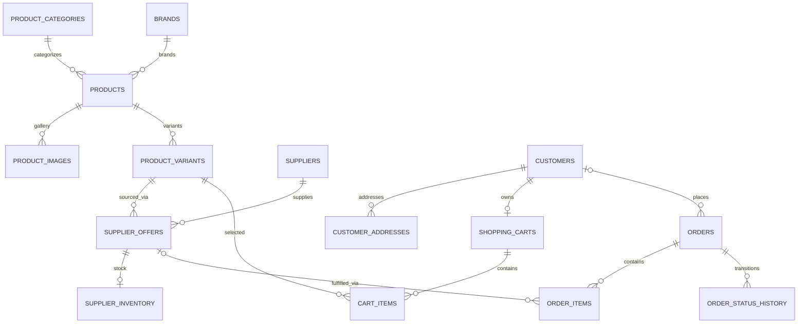

# Storefront database — 2026-11-11

## Scope and checklist

All 15 requested entity tables are defined in SQLAlchemy, versioned by Alembic, and present in the local development database. The nine additions are revision `20261111_0015`; the database now has 25 application tables including existing auth/review/outbox tables.

| Requirement | Table | Integration |
| --- | --- | --- |
| Products | products | Catalog and checkout; nullable category/brand FKs for legacy imports |
| Categories | product_categories | Unique slug, optional parent; product category FK |
| Brands | brands | Unique slug; explicitly marked demo records |
| Variants | product_variants | Product FK, unique SKU, storefront price and sellable-stock projection |
| Images | product_images | Product FK, ordered gallery, unique position per product |
| Suppliers | suppliers | Separate businesses from public brands; demo flag and active state |
| Supplier offers | supplier_offers | Supplier–variant join, internal cost/currency/SKU and lead time |
| Supplier inventory | supplier_inventory | One stock record per offer; on-hand/reserved quantities |
| Customers | customers | Verified account identity |
| Addresses | customer_addresses | Customer-owned saved addresses |
| Shopping carts | shopping_carts | Customer-owned server cart; hashed guest-token ownership supported by schema |
| Cart items | cart_items | Cart–variant FK, positive quantity, unique variant per cart |
| Orders | orders | Customer FK plus immutable checkout/customer/address snapshots |
| Order items | order_items | Variant and optional selected supplier-offer FK; purchase snapshots |
| Order status history | order_status_history | Transactional checkout/payment/cancellation records with deduplicated event key |

## Relationships

One product can have multiple variants, and each variant can have offers from multiple suppliers. The offer is the normalized product–supplier relationship; no duplicate product–supplier join table is required. Brands are not automatically suppliers. Historical `supplier_name` remains a compatibility display snapshot, not an authoritative supplier identity.

Foreign keys, unique constraints and checks enforce references, nonnegative costs/stock/lead times, positive cart quantities/minimum order quantity, reserved stock no greater than on-hand, exactly one cart owner, and unique cart lines/gallery positions/event keys. SQLite foreign keys are enabled per application connection. Supplier offers referenced by orders cannot be deleted; product/category/brand links and legacy snapshots remain backward compatible.

## Connected dummy data

Local backfill creates **5 categories, 2 demo brands, 7 images, 2 fictional suppliers, 7 offers and 7 inventory records**, covering all 7 current products/variants. Supplier names are “Demo Cuddle Supply” and “Demo Giant Plush Wholesale”; contacts use the reserved `.example` domain. Costs are synthetic fixture values, not commercial agreements.

`link_demo_catalog()` adds missing relations without resetting stock or overwriting existing inventory/offers. Both this function and the catalog seed reject production use. Running the seed repeatedly no longer replenishes sold/reserved variant stock. Legacy orders, if present, receive only a truthful `legacy_snapshot`, not invented past transitions. No dummy customers/orders/carts were created in the live database.

Catalog responses expose category/brand IDs, brand name and ordered images. Internal supplier contacts, supplier SKU and cost are not serialized. Existing category/supplier display fields and fallback images remain compatible with current storefront components.

## Storefront behavior

- Verified accounts use `GET/PUT /v1/cart`; PUT requires CSRF and rejects submitted prices/unknown fields. Quantities/variants/stock are validated; carts do not reserve stock.
- Account cart sync restores remote-only lines using product IDs, merges guest/account variants using maximum quantity (not addition), serializes/debounces writes, and isolates account switches/logout. Failed loading never overwrites an unknown remote cart. Guest carts remain browser-local; guest-token schema support is not a guest API implementation.
- Checkout locks variants and atomically reserves a suitable active supplier offer. Its ID is snapshotted on the order item. Price remains server-calculated storefront price; supplier cost is never used as customer input.
- Successful payment consumes reserved supplier stock. Expired/failed sessions release reservations and restore sellable variant stock. Existing webhook event/order guards prevent duplicate side effects. Stripe errors roll back reservations.
- Checkout, payment and cancellation write status history within their existing transactions. Supplier/admin users, permissions, portal screens, fulfillment edits and their future history transitions are not implemented.

## Deliberate limits before real suppliers

- Unlinked legacy variants retain the existing checkout stock fallback. Linked variants without valid supplier stock are rejected by cart/checkout. Catalog availability and price filtering now share supplier-aware availability. Revision 0017 adds a trusted internal snapshot-sync adapter that updates inventory and the sellable-stock projection; automatic external supplier-feed ingestion is still not implemented. Do not edit raw inventory independently and assume the projection updates automatically.
- Supplier minimum-order quantity and lead time are stored for future procurement. This storefront does not execute wholesale purchase orders, split one line across suppliers, automate fulfillment, or synchronize supplier feeds.
- A paid event arriving after an order was cancelled is not allowed to consume a released reservation or revive the order. Such reconciliation/refund cases need operational monitoring before production.
- Cart sync is eventual and browser-driven, not collaborative real-time cart editing. A stale cart containing an unpublished/deleted product is retained rather than destructively replaced on hydration failure.

## Migration and validation

The populated local SQLite database was backed up before applying **only revision 0015** after checking its legacy tables/columns. Existing customer/product/variant counts were unchanged, and the backfill reports zero FK violations. Its previously unversioned Alembic baseline remains unversioned; it was not blindly stamped or replayed from revision 0001. Modern SQLite additive inline references avoid rebuilding referenced tables; downgrade requires SQLite 3.35+.

PostgreSQL offline SQL generation passes through all 15 revisions. This is not online PostgreSQL execution certification; staging still needs full migration/rollback and concurrent-transaction testing. The existing PostgreSQL-specific earlier migration chain is unchanged.

Validation: **213 backend tests**, **19 frontend API/cart-sync tests**, TypeScript and targeted ESLint pass. Migration tests exercise populated SQLite upgrade/downgrade, constraints, orphan rejection and legacy-row preservation. Live home/shop/cart and product proxy return 200. No actual payment, supplier account provisioning or production deployment was performed.